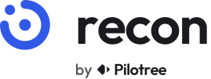

<p align="center">
  <picture>
    <source media="(prefers-color-scheme: dark)" srcset="assets/brand/recon-lockup-endorsed-reversed.svg">
    
  </picture>
</p>

# Recon

**Know what your competitors changed this week, without checking their websites.**

Recon is a plugin for [Claude Code](https://claude.com/claude-code). Tell it who your competitors are and it watches their pricing, homepage, changelog, blog, sitemap and job board. Each week it compares everything with last week and tells you only what actually changed, ranked by how much it matters, with the evidence for every line.

```
> run recon
```

```
Recon · week of 9 Nov 2026 · 4 competitors watched

The headline: Rival raised its Pro plan by 20%, a month after launching Workflows AI.

High
• Rival: Pro plan up from £49 to £59 a month. Starter unchanged.
  Read: first price rise we've seen, a month after their Workflows AI launch.
  rival.com/pricing · seen 9 Nov
• Other Co: new page comparing themselves to Acme.
  othercoapp.com/vs/acme · seen 9 Nov

Medium
• Rival: hiring their first Head of Partnerships, and 3 roles in Berlin (new location).
  jobs.ashbyhq.com/rival · seen 9 Nov

Quiet this week: Third Ltd
```

Post it to a Slack channel every Monday, or just ask for it when you want it.

---

## Why it exists

Everyone means to keep an eye on the competition. Nobody does.

- **Checking by hand doesn't happen.** Ten competitors, six pages each, every week. It's the first thing dropped in a busy week, and you hear about the price change from a customer.
- **Change-detection tools are noisy.** They alert you when a date or a testimonial changes, so you learn to ignore them, and then you miss the one change that mattered.
- **The best signals aren't on the homepage.** A new `/vs/your-company` page in their sitemap, a first Head of Sales in Germany on their job board, a feature quietly moved from Pro to Enterprise. You only see these by comparing week to week.
- **Intel tools cost thousands a year** and are built for big product-marketing teams.

Recon does the comparing for you, throws away the noise, and tells you what changed and why it might matter.

---

## How it works

```
  "Our competitors are Rival, Other Co and Third Ltd"
                     │
   0  Setup          Finds each one's pricing, changelog, blog, feeds, sitemap
                     and job board for you.                         ◆ you confirm
                     │
   1  Collect        One agent per competitor, in parallel. Saves a clean, dated
                     snapshot of each source. Public pages only.
                     │
   2  Diff           Compares with last week, drops the noise (dates, rotating
                     logos, typo fixes), turns real changes into signals.
                     │
   3  Digest         Top 10 signals, ranked High / Medium / Low, each with its
                     source and date. Saved, and posted to Slack if you want.
```

The first run takes a **baseline**: where every competitor stands today. Changes show up from the second run.

### What it watches

| Source | What counts as news |
|---|---|
| **Pricing** | Price up or down, plans added or removed, limits changed, features moved between plans, trial changes |
| **Homepage** | New headline (a positioning change), new main call to action ("Start free" → "Book a demo"), new navigation, big new customer logos |
| **Changelog and blog** | New entries and launches, read from RSS when there's a feed |
| **Sitemap** | New pages and sections: integrations, landing pages for a new market, and comparison pages that name you |
| **Jobs** | Hiring jumps, new departments, new countries, first senior hires. Reads public Greenhouse, Lever, Ashby and Workable boards |

---

## Install

```
/plugin marketplace add Pilotree-ai/recon
/plugin install recon@recon
```

The skill shows up as `recon:competitor-recon`. You don't need to call it by name.

**Needs:** Claude Code, and `curl` and `python3`, which come with macOS and most Linux systems. Slack is optional: connect it once in claude.ai Settings > Connectors.

---

## Things you can say

```
> watch Rival, Other Co and third.io for me
> run recon
> what's new with Rival?
> show Rival's pricing history
> add fourth.com to recon
> post the digest to #competitors every week
```

---

## Your workspace

Everything specific to you stays in your own folder:

```
recon/
  config.md                 your company, competitors, sources and Slack channel
  snapshots/
    rival/
      pricing/2026-11-09.md  a clean, dated copy of each source, kept for history
      jobs/2026-11-09.md
  digests/
    2026-11-09.md           each digest as sent
```

The snapshots are plain text, so you have a full history of every competitor's pricing and messaging. Keep `recon/` out of public repos. This repo's `.gitignore` already excludes it.

---

## Playing fair

Recon reads only what any visitor can see, and reads it politely:

- Public pages only. It never signs in or gets past a paywall or a demo-request form.
- It respects `robots.txt` and stops if a site blocks it, rather than trying to get round the block.
- One request at a time per site, only the pages you've chosen. It never crawls a whole site.
- No personal data: it keeps job titles and locations, never people's names.
- Facts and interpretation are kept apart. Anything that's a guess is labelled **Read:**.

---

## Good to know

- **Some sites block automated reads.** Recon says which sources it couldn't read in the digest footer, rather than guessing.
- **Prices can vary by country.** Recon saves what the page shows by default and notes the region.
- **Scheduling.** Run it yourself every Monday, or set up a recurring routine. A cloud routine needs your `recon/` folder in a private git repo so it can see last week's snapshots.

---

## What's inside

```
skills/competitor-recon/
  SKILL.md              the run, the gates and where things live
  scripts/
    sitemap-urls.sh     every URL a site lists in its sitemaps, sorted, for diffing
    jobs.sh             open roles from public Greenhouse, Lever, Ashby and Workable boards
  references/
    rules.md            what may be read and kept, and how to report
    setup.md            first-run dialogue and source discovery
    sources.md          how each source is collected and saved
    diffing.md          noise to ignore, what counts as a signal, ranking
    digest.md           the digest and baseline formats, and Slack posting
  templates/
    config.template.md
```

---

## More from Pilotree

- **[Squawk](https://pilotree.ai/squawk):** Recon shows what competitors change on their sites. Squawk shows whether ChatGPT, Gemini and Perplexity recommend them, or you.
- **[Vetted](https://github.com/Pilotree-ai/vetted):** one sentence in, an approved, personalised outbound campaign out.
- **[Inboxed](https://github.com/Pilotree-ai/inboxed):** find out if your email lands in the inbox, and get the exact fix.

Built by [Pilotree](https://pilotree.ai). MIT licensed.
